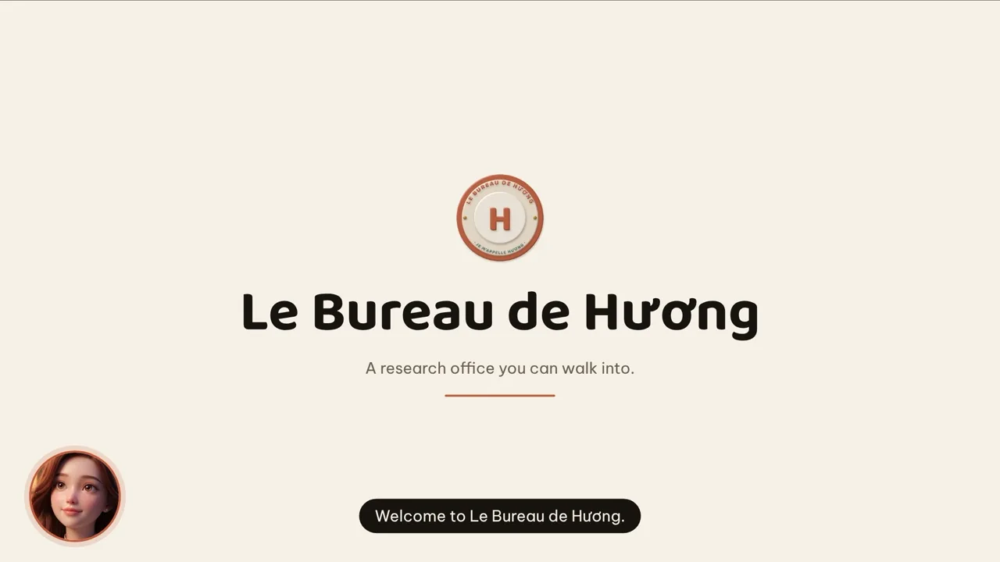
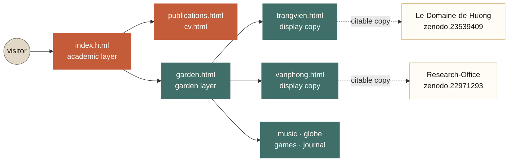

<div align="center">

<h1>Je m'appelle Hương</h1>

### A research homepage where the citable work and the playful work share one repository — and neither pretends to be the other.

**Đỗ Thùy Hương** · PhD candidate in Business Administration, Can Tho University

[](https://jemappellehuong.com/)
[](https://doi.org/10.5281/zenodo.22003853)
[](#-two-front-doors)

[](#-run-it)
[](#-run-it)
[](#-run-it)
[](#-licence)

<br>

<table>
<tr>
<td width="33%" align="center">
  <a href="https://jemappellehuong.com/trangvien.html">
    
  </a>
  <br><b>Trang viên</b><br><sub>Eight districts, four times of day,<br>three ways to travel</sub>
</td>
<td width="33%" align="center">
  <a href="https://jemappellehuong.com/vanphong.html">
    
  </a>
  <br><b>Le Bureau</b><br><sub>Five characters answer questions<br>about the dissertation</sub>
</td>
<td width="33%" align="center">
  <a href="https://jemappellehuong.com/music.html">
    
  </a>
  <br><b>Songbook</b><br><sub>Original recordings with<br>synchronised lyrics</sub>
</td>
</tr>
</table>

### [▶&nbsp; Open the site](https://jemappellehuong.com/)

<sub>Visuals generated with Google Gemini; music by the author. Full inventory in [`THIRD-PARTY.md`](THIRD-PARTY.md).</sub>

</div>

---

## The short version

|  |  |
|---:|---|
| **11** | pages, plus a `404.html` that repairs old and mis-cased URLs instead of apologising |
| **3** | languages on every page — Vietnamese, English, French — switched without a reload |
| **13** | works archived on Zenodo, each with its own DOI |
| **1** | third-party script in the whole site: three.js, vendored so no page calls a CDN |
| **0** | build steps, bundlers, package managers, servers or databases |

> **Why no build step?** This repository is both the source and the deployable
> artefact. The archived release opens and reads without any toolchain — the one
> property that keeps a software deposit useful in ten years.

## 🚪 Two front doors

The site is split in two, and the split *is* the design: a visitor meets the
researcher first, and is then invited into the garden.



**The academic layer** — `index.html` · `publications.html` · `cv.html`

A visitor should be able to tell who this is, what she researches, and where the
CV and papers are **within the first screen**, in any language, on any device.
Identity above the fold with no floating widget over the name; the dissertation
question with its data and methods; publications tiered by evidence, each with
its DOI; courses taught, one line each, linked to open material.

**The garden layer** — `garden.html` and everything behind it

A hand-drawn estate map that a 3D character walks you through; an explorable 3D
estate with ambient audio and a small game; a 3D office where five characters
answer pre-written questions; original recordings with synchronised lyrics; live
World Bank data on a 3D globe; a blog, a creative journal and a guest book.

### The rule that holds it together

**The running copy stays in the ecosystem; the citable copy moves to its own
repository and is deposited on Zenodo.** `trangvien.html` and `vanphong.html` are
display copies — the versions a reviewer cites live in
[`Le-Domaine-de-Huong`](https://github.com/thuyhuongctu/Le-Domaine-de-Huong) and
[`Research-Office`](https://github.com/thuyhuongctu/Research-Office), each
self-contained, each with a DOI that freezes a single state of the work.

<details>
<summary><b>🇻🇳 Tóm tắt tiếng Việt</b></summary>

<br>

**Je m'appelle Hương** là trang học thuật cá nhân của **Đỗ Thùy Hương** —
nghiên cứu sinh tiến sĩ ngành Quản trị kinh doanh tại Trường Đại học Cần Thơ,
nghiên cứu về quốc tế hóa và hiệu quả hoạt động kinh doanh của doanh nghiệp ở
châu Á.

Trang có **hai cửa tách bạch**. *Trang chủ là hồ sơ học thuật*: tên, đơn vị công
tác, một câu nghiên cứu, CV, ORCID và email ngay màn hình đầu; rồi nghiên cứu,
công bố chọn lọc chia theo tầng bằng chứng, học phần giảng dạy và các dự án phần
mềm. *Vườn số* (`garden.html`) giữ toàn bộ phần sáng tạo: bản đồ trang viên,
nhân vật Hương AI, âm nhạc và songbook, trang viên 3D, văn phòng nghiên cứu 3D,
trò chơi lịch sử và quả cầu dữ liệu World Bank — chỉ cách trang chủ đúng một
liên kết.

Khách lần đầu gặp người nghiên cứu trước, rồi mới được mời vào vườn.

**Một nếp xuyên suốt:** bản *đang chạy* ở lại trong hệ sinh thái, còn bản *để
trích dẫn* tách sang kho riêng rồi nộp lên Zenodo lấy DOI. Trang viên và văn
phòng trên site này là bản trưng bày; bản có DOI nằm ở hai kho riêng.

Toàn bộ viết bằng HTML/CSS/JS thuần, không cần cài đặt, không cần build, chạy
trên GitHub Pages.

</details>

## ⚡ Run it

```bash
git clone https://github.com/thuyhuongctu/Je-mappelle-Huong.git
cd Je-mappelle-Huong
python3 -m http.server 8000      # → http://localhost:8000
```

That is the whole setup. Serving over HTTP is needed only for the service worker
and the install prompt; individual pages also open straight from disk.

Before pushing, one script guards three failures a browser never shows you:

```bash
python3 scripts/check-site.py
```

It catches a service worker pre-caching a file that no longer exists, a sitemap
that has drifted from the pages it describes, and internal links or anchors left
pointing nowhere after a rename. Each of those keeps the page looking perfectly
fine while something underneath is broken. It also runs on every pull request.

## 🧩 The ecosystem

Every tool below runs in a browser, needs no installation, and is archived with
its own DOI.

### Research and method

| Project | What it does | | |
|---|---|---|---|
| **M-AIDA** | Meta-Analysis Intelligent Data Assistant — LLM extraction of effect sizes with 100 % human verification | [site](https://thuyhuongctu.github.io/M-AIDA/) | [`zenodo.21282517`](https://doi.org/10.5281/zenodo.21282517) |
| **Gravity Lab** | A browser-based gravity-model laboratory for FDI into Vietnam | [site](https://thuyhuongctu.github.io/Gravity-Lab/) | [`zenodo.23330642`](https://doi.org/10.5281/zenodo.23330642) |
| **Distance, FDI and Trade** | Research code and data mappings (DA0–DA4) for the Vietnam FDI paper | — | [`zenodo.23115783`](https://doi.org/10.5281/zenodo.23115783) |
| **AIBIS Global Market Engine** | A deterministic engine for choosing international market-entry modes | [site](https://bizonland.com/aibis-entry-mode-preview.html) | [`zenodo.23317597`](https://doi.org/10.5281/zenodo.23317597) |
| **Le Bureau de Hương** | An offline 3D research office with a mode-of-entry board for International Business teaching | [site](https://thuyhuongctu.github.io/Research-Office/) | [`zenodo.22971293`](https://doi.org/10.5281/zenodo.22971293) |
| **Le Domaine de Hương** | The 3D estate as a standalone work: eight zones, four lighting states, five gameplay modules, no network request at all | [site](https://thuyhuongctu.github.io/Le-Domaine-de-Huong/) | [`zenodo.23539409`](https://doi.org/10.5281/zenodo.23539409) |

### Teaching

| Project | What it does | | |
|---|---|---|---|
| **BizOn Bật Nghiệp** | A 3D claymorphism business-simulation game for entrepreneurship education | [site](https://bizonland.com/) · [Play](https://play.google.com/store/apps/details?id=io.github.thuyhuongctu.bizon) | [`zenodo.21628970`](https://doi.org/10.5281/zenodo.21628970) |
| **EnQuiz** | An offline-first bilingual quiz app for entrepreneurship revision — 300 questions, installable | [site](https://thuyhuongctu.github.io/EnQuiz/) · [Play](https://play.google.com/store/apps/details?id=io.github.thuyhuongctu.enquiz) | [`zenodo.21879706`](https://doi.org/10.5281/zenodo.21879706) |
| **ComDraft** | A full teaching package: five lecture decks, three lab workbooks, a 200-question bank, eight subtitled videos and an offline revision app | [site](https://thuyhuongctu.github.io/ComDraft/) | [`zenodo.22003676`](https://doi.org/10.5281/zenodo.22003676) |
| **Vietnamese history games** | Vân Đồn (1149), Bắc Hải Đảo (1780, 2D and 3D), Chợ Nổi (19th century) | [site](https://thuyhuongctu.github.io/ThuyHuong_Digital-2026-Games/) | [`zenodo.21850564`](https://doi.org/10.5281/zenodo.21850564) |

### Music

| Project | What it does | | |
|---|---|---|---|
| **We Create Tomorrow** | Bilingual karaoke for the anthem of the School of Economics, Can Tho University — with Assoc. Prof. Dr. Phan Anh Tu | [site](https://thuyhuongctu.github.io/we-create-tomorrow/) | [`zenodo.22080060`](https://doi.org/10.5281/zenodo.22080060) |
| **Chansonia** | A lyrics-synchronised player for the album «La lampe, le fleuve et les couleurs» | [site](https://thuyhuongctu.github.io/Chansonia/) | [`zenodo.22172794`](https://doi.org/10.5281/zenodo.22172794) |

> 🎓 **PhD dissertation** — *Internationalization and firm performance among
> enterprises in Asia*, on World Bank Enterprise Survey data across 50 economies,
> with a meta-analysis of 236 coded studies (K = 286 effects, 49 economies).
> A full page follows on publication.

<details>
<summary><b>🛠 Technology and repository layout</b></summary>

<br>

| Layer | Implementation |
|---|---|
| Pages | Plain HTML5, CSS and vanilla JavaScript; no framework, no build step |
| 3D | [three.js](https://threejs.org/) r128, vendored in `assets/vendor/` so no page calls a CDN |
| Data | World Bank Open Data API; Zenodo API for live download statistics |
| Audio | Web Audio API for ambience; HTML5 audio for recordings |
| App platform | Progressive Web App — web manifest, service worker with a versioned cache |
| Hosting | GitHub Pages, deployed by Actions on every push to the default branch |
| Archiving | Releases deposited in [Zenodo](https://doi.org/10.5281/zenodo.22003853) with a DOI |

```
.
├── index.html               Academic home: research, publications, teaching, CV
├── publications.html        Full publication list, filterable by type and year
├── cv.html                  Printable CV
├── garden.html              Digital garden: the map, character, music, globe
├── blog.html                Academic news blog
├── journey.html             Creative journal: how the site was made
├── trangvien.html           3D estate — display copy of Le-Domaine-de-Huong
├── vanphong.html            3D research office — display copy of Research-Office
├── music.html               Recordings, song list and synchronised lyrics
├── audio.html               Narration studio: record the tour voice (VI/EN/FR)
├── so-luu-niem.html         Guest book: a curated wall, plus a form to write in
├── 404.html                 Recovers old and mis-cased URLs back into the site
├── songbook.html            Redirect stub → music.html (old URL kept alive)
├── quan-ly-songbook.html    Redirect stub → music.html (old URL kept alive)
│
├── assets/
│   ├── css, js, img, audio, video, data
│   ├── js/office-builder.js, js/characters.js   The office, split into modules
│   ├── vendor/              three.js r128 — the only third-party script
│   └── fonts/               Be Vietnam Pro and Baloo 2, subset to Vietnamese
│                            and self-hosted; no page calls Google Fonts
├── scripts/                 rebuild-sitemap.py, check-site.py
├── .github/workflows/       check-site.yml (every PR), update-sitemap.yml, pages.yml
│
├── deck-ecosystem/          Ecosystem slide deck, PDF export and design spec
├── design-demos/            Design directions and the approval record
├── docs/                    Working notes: music-video plan, estate work log
├── ho-so-quyen-tac-gia/     Copyright-registration dossier (drafts, no ID data)
│
├── icons/                   Application icon set
├── manifest.webmanifest     Web application manifest
├── sw.js                    Service worker (versioned offline cache)
├── zenodo-stats.js          Live Zenodo download statistics
├── sitemap.xml, robots.txt  Search-engine metadata
├── CITATION.cff             Citation metadata (GitHub "Cite this repository")
├── LICENSE, THIRD-PARTY.md  Terms of use; inventory of third-party components
└── CLAUDE.md                Repository conventions for the coding assistant
```

</details>

<details>
<summary><b>🔒 Privacy and security</b></summary>

<br>

The site is **static**. There is no server, no database, no login and no
content-management system: GitHub Pages returns files exactly as committed here.
A visitor has no way to alter what anyone else sees — the only route to changing
a page is write access to this repository, governed by GitHub account security
and branch protection, not by anything in the code.

| Concern | How it stands |
|---|---|
| Credentials in the repository | None. No API key, token or password is used by any page; the site calls no authenticated service. |
| Personal data | Only what the author publishes deliberately: name, affiliation, ORCID and a public contact address. The dossier in `ho-so-quyen-tac-gia/` carries drafts only; identity-document fields are left as `«…»` placeholders, and `ho-so-quyen-tac-gia/rieng-tu/` is excluded by `.gitignore`. |
| Third-party scripts | None loaded from a CDN. three.js r128 is vendored, so no page depends on an external host that could change its contents under a fixed URL. |
| Web fonts | Self-hosted. No page contacts Google Fonts, so a visitor's IP is never sent to a font server before the first character is drawn. |
| Visitor-supplied text | The guest-book wall is a curated file, `assets/data/so-luu-niem.json`, edited by hand after reading each message. Entries render with `textContent`, never `innerHTML`, so no submitted text can execute as markup. The write box posts to a Google Form owned by the author; nothing is published automatically. |
| Stored in the browser | `localStorage` only — the visitor's own language (`huong_lang`) and theme (`huong_theme`) choice, and game progress in the 3D estate. Never read back by the author; no cookie is set. |
| Analytics | [GoatCounter](https://www.goatcounter.com/), which collects no personal data and sets no cookie. |
| Continuous integration | `check-site.yml` runs on pull requests with `permissions: contents: read` and `persist-credentials: false`, so an untrusted branch cannot obtain a writable token. `update-sitemap.yml` needs `contents: write` but fires only on pushes to the default branch or by manual dispatch. |

</details>

<details>
<summary><b>🎬 Authoring tools</b></summary>

<br>

Agent skills used to produce the site's media live under `.claude/skills/`:

- **MiniMax H3 video skills** (from
  [thuyhuongctu/MiniMax-H3](https://github.com/thuyhuongctu/MiniMax-H3)) for
  short-form video: prompt writing, brand promotion, 3D animation, music-video
  subtitling, product advertising and several illustrated explainer styles.
  Rendering runs through [hailuoai.video](https://hailuoai.video/tools/minimax-h3)
  or the MiniMax API.
- **huashu-design** (MIT, from
  [alchaincyf/huashu-design](https://github.com/alchaincyf/huashu-design)) for
  interactive prototypes, 1920×1080 HTML slide decks, motion design and design
  review. Installed in reduced form; see
  `.claude/skills/huashu-design/LOCAL-NOTE.md`.

Longer-form video uses [OpenMontage](https://github.com/calesthio/OpenMontage)
(AGPL-3.0) as an external tool, deliberately **not** vendored here:

```bash
GIT_LFS_SKIP_SMUDGE=1 git clone --depth 1 https://github.com/calesthio/openmontage
```

It needs Python 3.10+, FFmpeg and Node 18+, and offers a fully free generation
path (Piper TTS, Pexels, Archive.org) without API keys.

</details>

## 📑 How to cite

[](https://doi.org/10.5281/zenodo.22003853)

Citation metadata is maintained in [`CITATION.cff`](CITATION.cff); GitHub's
**Cite this repository** control exports APA and BibTeX from that file.

> Do, T. H. (2026). *Je m'appelle Hương: personal academic homepage*
> [Computer software]. Zenodo. https://doi.org/10.5281/zenodo.22003853

```bibtex
@software{do_je_mappelle_huong_2026,
  author    = {Do, Thuy Huong},
  title     = {{Je m'appelle Hương: personal academic homepage}},
  year      = {2026},
  publisher = {Zenodo},
  version   = {1.0},
  doi       = {10.5281/zenodo.22003853},
  url       = {https://doi.org/10.5281/zenodo.22003853}
}
```

The DOI above is the **concept DOI**: it represents all versions and always
resolves to the most recent release. Individual releases carry their own:

| Version | Released | DOI |
|---|---|---|
| 1.0 | 18 August 2026 | [10.5281/zenodo.22003854](https://doi.org/10.5281/zenodo.22003854) |

## 📜 Licence

**© 2026 Đỗ Thùy Hương. All rights reserved.**

This work is published for reading, consultation and citation. It is **not**
released under an open-source or open-content licence. No permission is granted
to copy, redistribute, republish, modify, translate or reuse the site, its
source code, its written content, its images, its recordings or the *Hương AI*
character, in whole or in part, for any purpose, without the prior written
permission of the author.

Quotation for academic purposes, with attribution and a citation to the record
above, is permitted under normal scholarly practice and applicable copyright
exceptions.

Permission requests → [thuyhuongctu@gmail.com](mailto:thuyhuongctu@gmail.com)

Third-party components keep their own licences and are not covered by the
reservation above:

| Component | Use | Licence |
|---|---|---|
| [three.js](https://threejs.org/) r128 | 3D scenes, vendored in `assets/vendor/` | MIT |
| [Be Vietnam Pro](https://github.com/bettergui/BeVietnamPro) | Body typeface, subset into `assets/fonts/` | OFL 1.1 |
| [Baloo 2](https://github.com/EkType/Baloo2) | Display typeface, subset into `assets/fonts/` | OFL 1.1 |
| [huashu-design](https://github.com/alchaincyf/huashu-design) | Design skill, `.claude/skills/` | MIT |
| [OpenMontage](https://github.com/calesthio/OpenMontage) | External video tool, not vendored | AGPL-3.0 |

The full inventory, including every generated image, video and recording, is in
[`THIRD-PARTY.md`](THIRD-PARTY.md).

## 👤 Author

**Đỗ Thùy Hương** (Do Thuy Huong)
PhD candidate in Business Administration, Can Tho University

[](https://orcid.org/0000-0002-7711-2487)
[](https://scholar.google.com/citations?hl=vi&user=jSvAVnsAAAAJ)
[](https://osf.io/m25qs/)
[](mailto:thuyhuongctu@gmail.com)

---

<div align="center">
<sub>© 2026 Đỗ Thùy Hương. All rights reserved.</sub>
</div>
